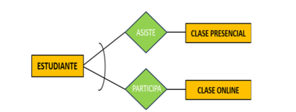
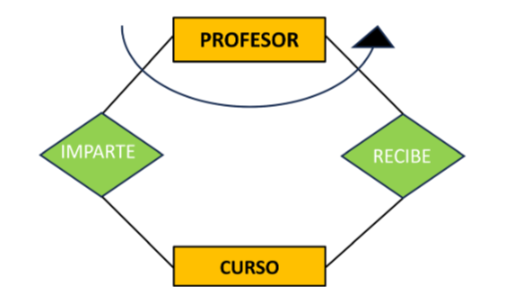
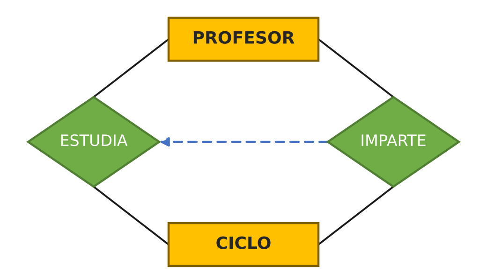
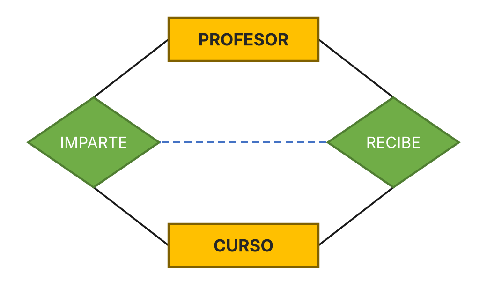
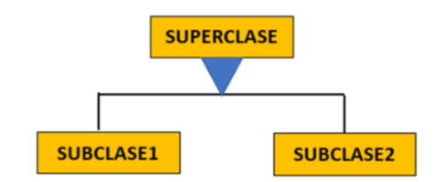
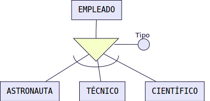
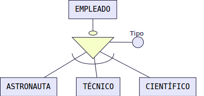
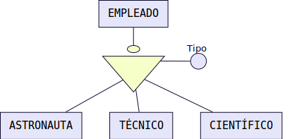
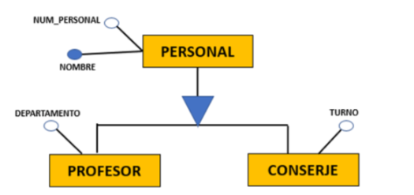
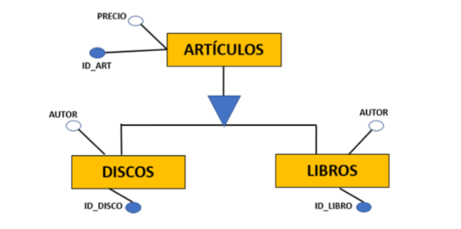

# Tema 5 — El Modelo Entidad-Relación Extendido

---

## Índice

1. [Introducción](#1-introducción)
2. [Restricciones sobre las relaciones: Exclusividad](#2-restricciones-sobre-las-relaciones-exclusividad)
3. [Restricciones sobre las relaciones: Inclusividad](#3-restricciones-sobre-las-relaciones-inclusividad)
4. [Restricciones sobre las relaciones: Inclusión](#4-restricciones-sobre-las-relaciones-inclusión)
5. [Restricciones sobre las relaciones: Exclusión](#5-restricciones-sobre-las-relaciones-exclusión)
6. [Jerarquías: Generalización](#6-jerarquías-generalización)
7. [Jerarquías: Especialización](#7-jerarquías-especialización)
8. [Jerarquías: Herencia](#8-jerarquías-herencia)

---

## 1. Introducción

El modelo E/R que vimos en el Tema 4 (entidades, atributos y relaciones) es potente, pero nació en los años 70 con un alcance limitado. Con el tiempo se le fueron añadiendo elementos para poder representar casos más complejos: es lo que se conoce como **modelo entidad-relación extendido (EER)**.

> 💡 El modelo EER **no sustituye** al modelo E/R original — lo complementa. Todo lo que aprendimos en el Tema 4 se sigue usando; aquí simplemente añadimos herramientas nuevas para los casos que se quedan cortos con entidades, atributos y relaciones básicas.

Las extensiones que vamos a ver en este tema son tres bloques:

```
MODELO E/R EXTENDIDO
      │
      ├── Restricciones sobre relaciones → exclusividad, inclusividad, inclusión, exclusión
      ├── Jerarquías                     → generalización, especialización, herencia
      └── Agregación
```

---

## 2. Restricciones sobre las relaciones: Exclusividad

Ocurre cuando una entidad participa en **dos o más relaciones distintas**, pero **cada ocurrencia solo puede vincularse a una de ellas a la vez** — nunca a ambas simultáneamente.

Se representa gráficamente con un **arco** que abarca las relaciones y la entidad implicada:



**Ejemplo:** un estudiante puede asistir a una clase presencial *o* participar en una clase online, pero no en ambas al mismo tiempo.

Otro ejemplo: un MÉDICO puede TRABAJAR EN una consulta privada o ATENDER EN un hospital público, pero no en ambos sitios a la vez.

---

## 3. Restricciones sobre las relaciones: Inclusividad

Se aplica cuando **participar en una relación obliga a participar también en otra**, aunque las ocurrencias concretas involucradas no tengan por qué coincidir.

**Ejemplo:** para que un PROFESOR pueda IMPARTIR la asignatura de Bases de Datos, debe haber RECIBIDO antes una ingeniería informática o de telecomunicaciones. El curso que imparte no es el mismo que el que recibió, pero la participación en IMPARTE exige haber participado antes en RECIBE.

Se representa con un **arco terminado en flecha**, que apunta a la relación que debe cumplirse obligatoriamente:



*(el arco con flecha conecta IMPARTE ← RECIBE, indicando que impartir exige haber recibido antes)*

> 💡 La cardinalidad mínima y máxima de esta restricción puede indicarse junto a la flecha.

---

## 4. Restricciones sobre las relaciones: Inclusión

Es una versión **más estricta** que la inclusividad: no solo exige que participar en una relación implique participar en otra, sino que **la ocurrencia concreta debe ser la misma en ambas relaciones**. Se aplica cuando una relación concreta está incluida dentro de otra más general.

Se representa con una **flecha discontinua** que apunta a la relación general (la que debe cumplirse obligatoriamente):



**Ejemplo:** para impartir un ciclo, un profesor tiene que haber estudiado ese mismo ciclo.

---

## 5. Restricciones sobre las relaciones: Exclusión

Parecida a la exclusividad, pero más estricta: cuando **una ocurrencia concreta está vinculada a otra ocurrencia concreta mediante una relación**, no puede estar simultáneamente vinculada a esa misma ocurrencia mediante otra relación.

Se representa uniendo ambas relaciones con una **línea discontinua**:



**Ejemplo:** si un profesor concreto está impartiendo un curso concreto, no puede estar recibiendo *ese mismo* curso a la vez.

---

## 6. Jerarquías: Generalización

Las **jerarquías** son otra extensión del modelo EER, y se basan en tres conceptos relacionados: **generalización**, **especialización** y **herencia**.

Una entidad es una **generalización** de un grupo si cada ocurrencia de las entidades del grupo es también una ocurrencia de esa entidad general. Aquí aparecen dos conceptos clave:

- **Superclase (superentidad)** — el conjunto de entidades de nivel superior.
- **Subclase (subentidad)** — los conjuntos de entidades de nivel inferior.

Se representa gráficamente con un **triángulo**:



---

## 7. Jerarquías: Especialización

Es el concepto complementario a la generalización: las subentidades pueden verse como **especializaciones** de la entidad principal. Existen cuatro variantes, que se pueden combinar dos a dos (exclusiva/inclusiva + total/parcial):

### 7.1. Especialización exclusiva y parcial

- Cada ocurrencia de la superclase solo puede pertenecer a **una** de las especializaciones.
- Se representa con un **arco** junto al triángulo.



*Ejemplo: un empleado sólo puede desempeñar una de las tres ocupaciones (exclusiva) . Además puede ser técnico, o ser astronauta, o ser científico o también desempeñar otro empleo diferente, por ejemplo, podría ser FÍSICO (parcial).*

### 7.2. Especialización inclusiva y parcial

- Las instancias de la superclase **sí pueden pertenecer** a varias subclases a la vez.
- Se representa solo con el triángulo, **sin** el arco.


*Ejemplo: un empleado podría ser simultáneamente técnico, científico y astronauta o técnico y astronauta, etc. (inclusiva). Además puede ser técnico, astronauta, científico o desempeñar otro empleo diferente (parcial)..*


### 7.3. Especialización exclusiva y total

- Cada ocurrencia de la superclase pertenece a **una y solo una** de las especializaciones.
- Se representa con el **arco** y el **círculo** sobre el triángulo.



*Ejemplo: Un empleado puede ser solamente técnico, astronauta o científico (total) y no ocupar más de un puesto (exclusiva)*

### 7.4. Especialización inclusiva y total

- Cada ocurrencia de la superclase pertenece a **al menos una** de las especializaciones, y puede pertenecer a varias.
- Se representa con el **círculo** sobre el triángulo, **sin** arco.



*Ejemplo: un empleado podría ser simultáneamente técnico, científico y astronauta o técnico y astronauta, etc. (inclusiva). Además puede ser solamente técnico, astronauta o científico (total).*

---

## 8. Jerarquías: Herencia

La **herencia** es lo que da sentido a toda la jerarquía: una subentidad **hereda los atributos** de su superentidad. Además, si la superentidad participa en una relación, las subclases relacionadas también participan en ella.



*Lectura: PROFESOR y CONSERJE heredan NUM_PERSONAL (clave) y NOMBRE de PERSONAL, y añaden sus propios atributos específicos (DEPARTAMENTO y TURNO).*

También puede pasar que cada subentidad tenga **su propia clave**, sin heredarla de la superentidad:



*Ambas subentidades heredan PRECIO, pero cada una tiene su propio identificador.*

---

## Resumen del tema

```
MODELO E/R EXTENDIDO
│
├── Restricciones
│    ├── Exclusividad
│    ├── Inclusividad
│    ├── Inclusión
│    └── Exclusión
│
├── Jerarquía
     ├── Generalización
     ├── Especialización
     │    ├── Exclusiva / Inclusiva
     │    └── Total / Parcial
     └── Herencia


```
