# Tema 7 — Modelo relacional: transformación del E/R y normalización

---

## Índice

1. [Introducción](#1-introducción)
2. [Transformación de entidades fuertes](#2-transformación-de-entidades-fuertes)
3. [Transformación de entidades débiles y relaciones 1:1](#3-transformación-de-entidades-débiles-y-relaciones-11)
4. [Transformación de relaciones 1:N y N:M](#4-transformación-de-relaciones-1n-y-nm)
5. [Atributos especiales, relaciones reflexivas y ternarias](#5-atributos-especiales-relaciones-reflexivas-y-ternarias)
6. [Transformación de jerarquías y restricciones](#6-transformación-de-jerarquías-y-restricciones)
7. [Normalización](#7-normalización)
8. [Dependencias funcionales](#8-dependencias-funcionales)
9. [Primera, segunda y tercera forma normal](#9-primera-segunda-y-tercera-forma-normal)
10. [Forma normal de Boyce-Codd](#10-forma-normal-de-boyce-codd)
11. [Formas normales restantes: 4FN, 5FN y dominio-clave](#11-formas-normales-restantes-4fn-5fn-y-dominio-clave)
12. [Desnormalización](#12-desnormalización)
13. [Ejercicios](#13-ejercicios)
14. [Resumen del tema](#resumen-del-tema)

---

## 1. Introducción

Ya sabemos construir un diagrama E/R (Tema 4 y 5). Ahora toca el paso decisivo del **diseño lógico**: **transformar el diagrama E/R en tablas relacionales**, aplicando un conjunto de reglas bien definidas.

Pero no basta con transformar: el resultado también debe estar **normalizado**, es decir, libre de redundancias y dependencias mal planteadas. Este tema cierra el Bloque 2 con estas dos piezas: **transformación** y **normalización**.

El diseño de una base de datos se hace en **tres niveles**:

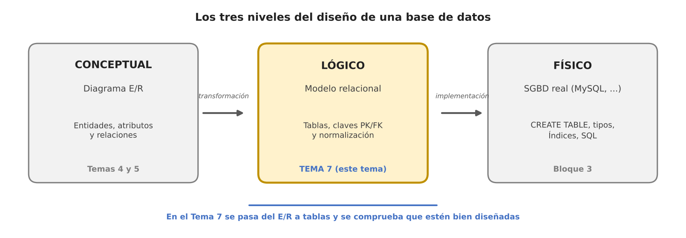

- **Conceptual (Temas 4 y 5):** el diagrama E/R. Describe *qué* datos hay, sin pensar en ningún SGBD.
- **Lógico (este tema):** el modelo relacional. Convierte el E/R en **tablas**, con sus claves primarias y foráneas, y comprueba que estén bien diseñadas (normalización).
- **Físico (Bloque 3):** el SGBD real (MySQL, etc.). Aquí se escribe el `CREATE TABLE`, se eligen tipos de datos...

> 💡 En este tema trabajamos sobre el papel: dibujamos tablas, pero todavía no escribimos SQL. Lo que aprendamos aquí es lo que después traduciremos a SQL en el Bloque 3.

Este tema tiene **dos bloques**:

1. **Transformación** (apartados 2–6): cómo pasar de un diagrama E/R a tablas.
2. **Normalización** (apartados 7–12): cómo comprobar que unas tablas están bien diseñadas, y cómo corregirlas si no lo están. Tiene sus propios ejercicios.

### 1.1. Claves primarias y foráneas (PK y FK)

Antes de empezar, dos conceptos que usaremos en todo el tema:

- **Clave primaria (PK, *Primary Key*):** columna (o conjunto de columnas) que **identifica de forma única** cada fila. No puede repetirse ni ser nula.
- **Clave foránea (FK, *Foreign Key*):** columna que contiene el valor de la clave primaria de **otra tabla** (o de la misma). Es el mecanismo que **relaciona** las tablas.

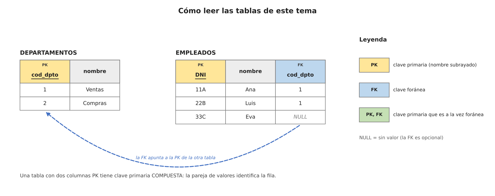

En las figuras usaremos siempre estos colores: **amarillo** = PK, **azul** = FK, **verde** = PK que además es FK. Si hay **dos columnas PK**, la clave primaria es **compuesta**: lo que identifica la fila es la *pareja* de valores.

En el texto escribiremos los esquemas así (la PK **subrayada** en las figuras, aquí indicada con `PK`):

```
EMPLEADOS (DNI, nombre, cod_dpto)
    PK: DNI
    FK: cod_dpto → DEPARTAMENTOS(cod_dpto)
```

> 💡 Una FK solo puede tomar **valores que existan** en la PK a la que apunta (o `NULL`, si la participación es opcional). A esto se le llama **integridad referencial**.

---

## 2. Transformación de entidades fuertes

Es el primer paso, y el más sencillo:

1. Cada **entidad fuerte** se convierte en una **tabla**.
2. Cada **atributo** se convierte en una **columna**.
3. Cada **ocurrencia** de la entidad es una **fila**.
4. El **identificador** de la entidad se convierte en la **clave primaria**.

| Elemento en el modelo E/R | Elemento equivalente en el relacional |
|---|---|
| Entidad | Tabla |
| Atributo | Columna |
| Ocurrencia | Fila |
| Identificador principal | Clave primaria (PK) |
| Identificador secundario | Clave candidata (`UNIQUE`) |

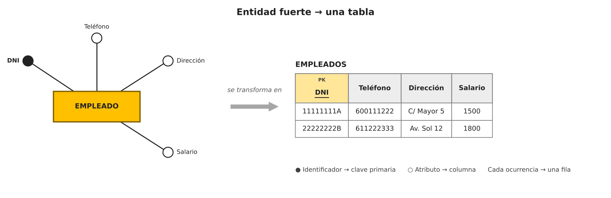

```
EMPLEADOS (DNI, Teléfono, Dirección, Salario)
    PK: DNI
```

---

## 3. Transformación de entidades débiles y relaciones 1:1

### 3.1. Entidades débiles

Una entidad débil no se puede identificar por sí sola: depende de una entidad fuerte. Por eso su tabla lleva:

- **FK** con la clave de la entidad fuerte (obligatoria: un movimiento no existe sin cuenta).
- **PK compuesta** = *clave de la fuerte* + *clave parcial* de la débil.

Es decir, la clave de la fuerte es **a la vez FK y parte de la PK** de la débil.

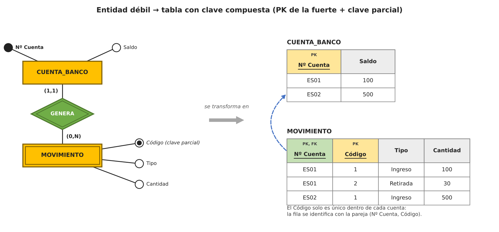

```
CUENTA_BANCO (Nº_Cuenta, Saldo)
    PK: Nº_Cuenta

MOVIMIENTO (Nº_Cuenta, Código, Tipo, Cantidad)
    PK: (Nº_Cuenta, Código)
    FK: Nº_Cuenta → CUENTA_BANCO(Nº_Cuenta)
```

> 💡 Fíjate en la tabla: el `Código` 1 aparece en la cuenta ES01 y en la ES02. El código solo es único **dentro de cada cuenta**, por eso hace falta la pareja (Nº_Cuenta, Código) para identificar el movimiento.

> ⚠️ **No confundir con una subclase de una jerarquía** (apartado 6): la subclase tiene **una fila como máximo por cada fila de la superclase** (PK = FK sin más columnas). La entidad débil tiene **muchas filas por cada fila de la fuerte** (por eso necesita la clave parcial).

Ejemplo con otra entidad débil — SALA (fuerte) y BUTACA (débil, con `nº_butaca` como clave parcial):

```
SALA (id_sala, nombre)
    PK: id_sala

BUTACA (id_sala, nº_butaca, tipo)
    PK: (id_sala, nº_butaca)
    FK: id_sala → SALA(id_sala)
```

### 3.2. Relaciones 1:1

Una relación 1:1 **no necesita tabla nueva**. Se añade una FK en una de las dos tablas, y esa FK debe ser **única** (`UNIQUE`), para que no se pueda repetir y la relación siga siendo 1:1.

**¿En cuál de las dos tablas va la FK?** Depende de la participación (cardinalidad mínima):

| Cardinalidades | Dónde va la FK |
|---|---|
| (1,1) en un lado y (0,1) en el otro | En la entidad que **siempre participa** (así la FK nunca es `NULL`) |
| (1,1) en ambos lados | En cualquiera de las dos (se elige una) |
| (0,1) en ambos lados | Mejor una **tabla nueva** con las dos claves (evita muchos `NULL`) |

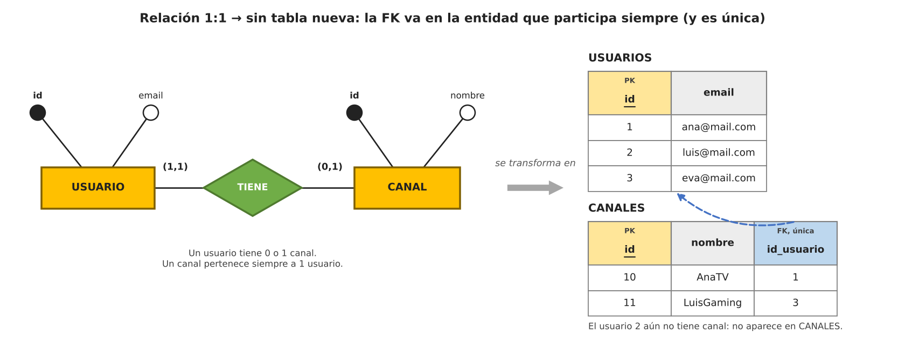

```
USUARIOS (id, email)
    PK: id

CANALES (id, nombre, id_usuario)
    PK: id
    FK: id_usuario → USUARIOS(id)     [UNIQUE, NOT NULL]
```

> ⚠️ Ponemos la FK **solo en una dirección**. Poner una FK en cada tabla (que se apunten entre sí) es redundante y complica los inserts: ¿cuál se crea primero?

---

## 4. Transformación de relaciones 1:N y N:M

### 4.1. Relaciones 1:N

Se añade la **clave del lado 1** como **FK en la tabla del lado N**. Los atributos de la relación (si los hay) también pasan a esa tabla. **No se crea tabla nueva.**

> 💡 Regla para saber el lado: la FK va en la tabla cuya entidad puede aparecer **muchas veces** (la que tiene la cardinalidad N *en el extremo opuesto* de la relación).

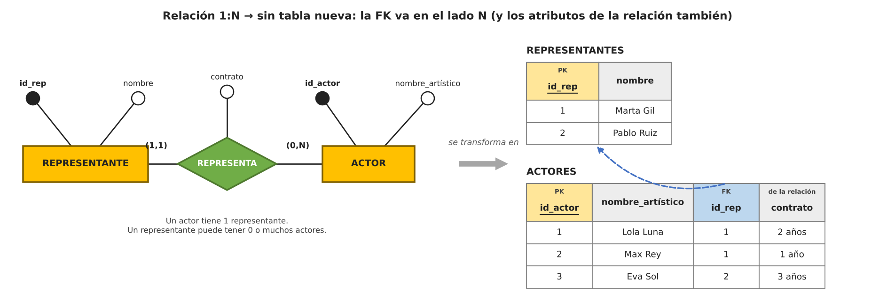

```
REPRESENTANTE (id_rep, nombre)
    PK: id_rep

ACTORES (id_actor, nombre_artístico, id_rep, contrato)
    PK: id_actor
    FK: id_rep → REPRESENTANTES(id_rep)
```

*Un representante (id 1) aparece en dos actores: así es 1:N. `contrato` es un atributo de la relación REPRESENTA, pero vive en ACTORES.*

### 4.2. Relaciones N:M

Aquí **sí** hace falta una **tabla nueva**. Contiene:

- Las **PK de las dos entidades**, como **FK**.
- Los **atributos de la relación**, si los hay.
- Su **PK es compuesta**: la pareja de las dos FK.

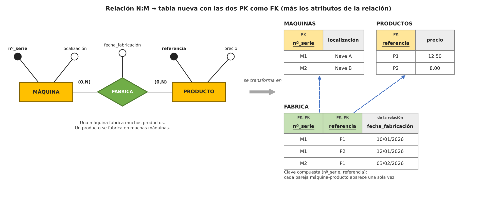

```
MAQUINAS (nº_serie, localización)         PK: nº_serie
PRODUCTOS (referencia, precio)            PK: referencia

FABRICA (nº_serie, referencia, fecha_fabricación)
    PK: (nº_serie, referencia)
    FK: nº_serie   → MAQUINAS(nº_serie)
    FK: referencia → PRODUCTOS(referencia)
```

> ⚠️ **Historial:** con la PK (nº_serie, referencia) cada pareja máquina–producto aparece **una sola vez**. Si la misma máquina puede fabricar el mismo producto varias veces y queremos guardar todas las fechas, hay dos soluciones: incluir la fecha en la PK → `PK: (nº_serie, referencia, fecha_fabricación)`, o convertir la relación en una **entidad asociativa** con su propio identificador.

### 4.3. Resumen de relaciones binarias

| Cardinalidad | ¿Tabla nueva? | Dónde va la FK |
|---|---|---|
| 1:1 | No (salvo (0,1)-(0,1)) | En la entidad que siempre participa, con `UNIQUE` |
| 1:N | No | En la tabla del lado N |
| N:M | **Sí** | Tabla nueva con las dos PK como FK (PK compuesta) |

---

## 5. Atributos especiales, relaciones reflexivas y ternarias

### 5.1. Relaciones reflexivas

Una relación de una entidad consigo misma. Se aplica la misma regla que en 1:N o N:M según la cardinalidad, pero la FK apunta **a la misma tabla**.

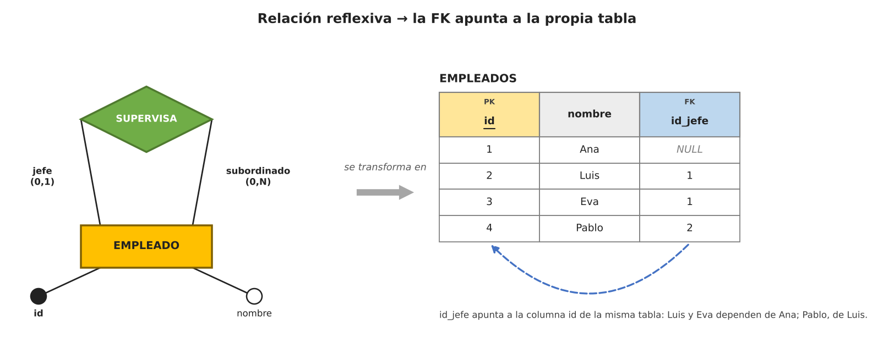

```
EMPLEADOS (id, nombre, id_jefe)
    PK: id
    FK: id_jefe → EMPLEADOS(id)       [puede ser NULL: el jefe máximo no tiene jefe]
```

### 5.2. Atributos multivaluados y derivados

- **Multivaluado** (puede tener varios valores, p. ej. los teléfonos de una persona): va a una **tabla propia** con la PK de la entidad como FK. La PK de la nueva tabla es compuesta (la FK + el valor).
- **Derivado** (se calcula a partir de otros, p. ej. la edad): **no se guarda**. Se calcula cuando se necesita. Guardarlo crearía redundancia y se desactualizaría.

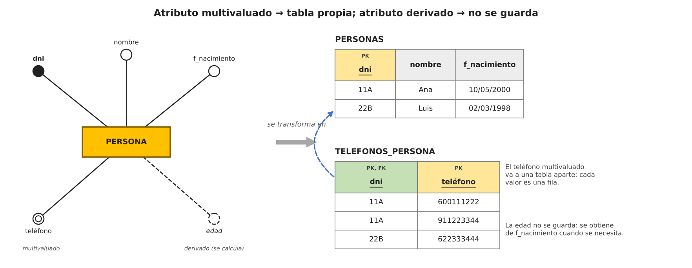

```
PERSONAS (dni, nombre, f_nacimiento)
    PK: dni

TELEFONOS_PERSONA (dni, teléfono)
    PK: (dni, teléfono)
    FK: dni → PERSONAS(dni)
```

### 5.3. Relaciones ternarias

Una relación entre **tres entidades** se transforma en una tabla con las **tres claves** como FK. Lo que cambia es **cuál es la PK**, y eso depende de las cardinalidades:

| Cardinalidades | Clave primaria de la tabla de la relación |
|---|---|
| N : N : N | Las tres claves juntas |
| N : N : 1 | Las dos claves de los lados **N**; la clave del lado **1** es solo FK |

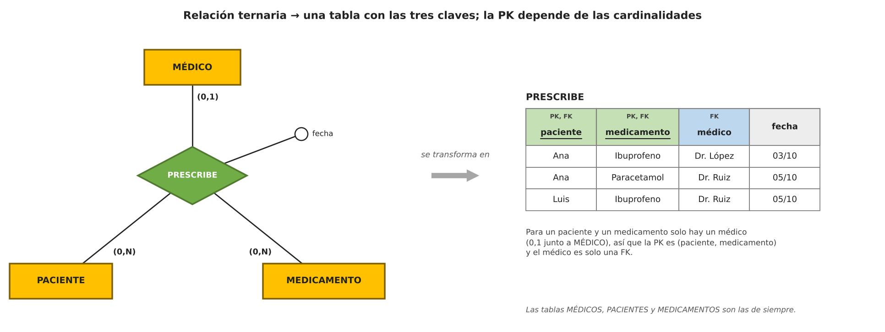

Ejemplo: un paciente puede recibir muchos medicamentos, un medicamento muchos pacientes, pero para un paciente y un medicamento concretos solo prescribe **un** médico (N:N:1):

```
PRESCRIBE (paciente, medicamento, médico, fecha)
    PK: (paciente, medicamento)
    FK: paciente    → PACIENTES(paciente)
    FK: medicamento → MEDICAMENTOS(medicamento)
    FK: médico      → MEDICOS(médico)
```

> 💡 Si una relación ternaria se complica, se puede sustituir por una **entidad asociativa** con su propio identificador y tres relaciones binarias. Es más fácil de entender y de transformar.

---

## 6. Transformación de jerarquías y restricciones

### 6.1. Jerarquías (generalización/especialización)

Recuerda las dos clasificaciones del Tema 5:

- **Exclusiva / inclusiva:** ¿una ocurrencia puede ser de una sola subclase (exclusiva) o de varias a la vez (inclusiva)?
- **Total / parcial:** ¿toda ocurrencia de la superclase pertenece a alguna subclase (total) o puede no pertenecer a ninguna (parcial)?

Hay **cuatro estrategias** para transformarla. Ejemplo de partida: EMPLEADO especializado en JEFE_PROYECTO y CONSULTOR.

**Estrategia 1 — Una tabla para la superclase y otra por cada subclase.** La PK de la subclase es la **misma** que la de la superclase, y a la vez FK hacia ella.

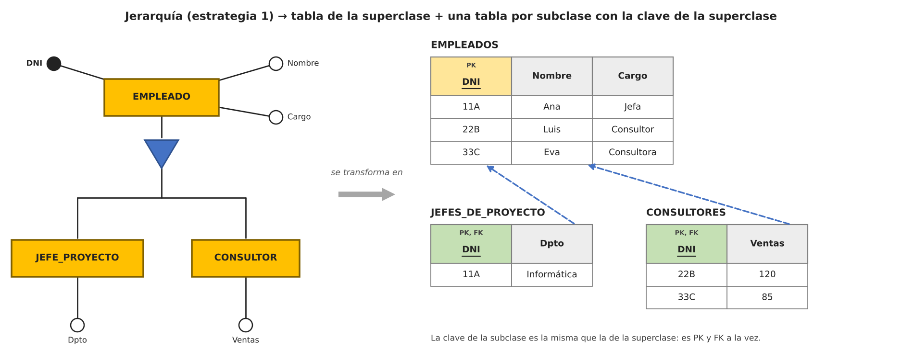

```
EMPLEADOS (DNI, Nombre, Cargo)                 PK: DNI
JEFES_DE_PROYECTO (DNI, Dpto)                  PK, FK: DNI → EMPLEADOS(DNI)
CONSULTORES (DNI, Ventas)                      PK, FK: DNI → EMPLEADOS(DNI)
```

**Estrategias 2, 3 y 4:**

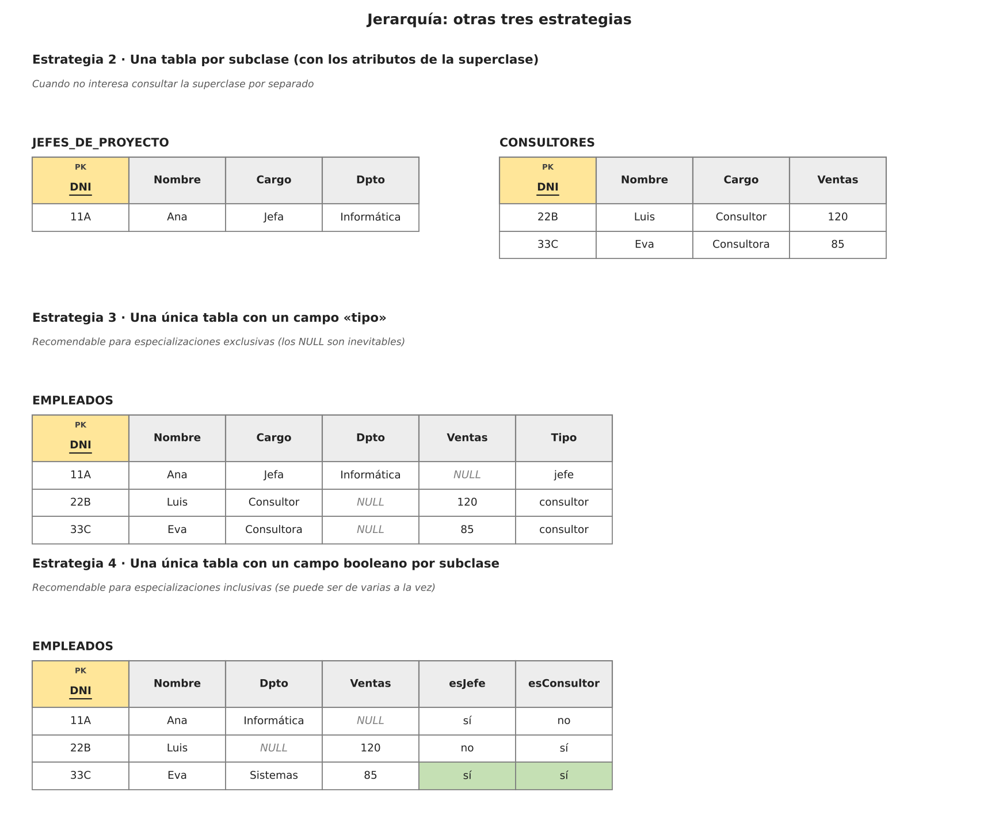

| Estrategia | Cuándo conviene | Inconveniente |
|---|---|---|
| **1. Superclase + una tabla por subclase** | Caso general; sirve para cualquier tipo de jerarquía | Hay que hacer `JOIN` para ver todos los datos |
| **2. Solo tablas de subclases** (con los atributos comunes repetidos) | Jerarquía **total y exclusiva**; no interesa consultar la superclase aparte | Si es inclusiva, los datos comunes se repiten; no hay forma de listar todos los empleados fácilmente |
| **3. Una sola tabla con un campo «tipo»** | Jerarquía **exclusiva** con pocos atributos específicos | Muchos `NULL` |
| **4. Una sola tabla con un booleano por subclase** | Jerarquía **inclusiva** (se puede ser de varias a la vez, como Eva) | Muchos `NULL` |

> 💡 Si la subclase tiene **su propio identificador** (por ejemplo, el consultor tiene `id_consultor` además del DNI), la tabla de la subclase usa su id como PK y añade el DNI como **FK `UNIQUE`** hacia la superclase.

### 6.2. Restricciones de inclusión y exclusión (Tema 5)

Dos relaciones entre las mismas entidades pueden tener restricciones entre sí. Al pasar a tablas:

- **Inclusión** (toda pareja de IMPARTE debe estar también en RECIBE): **FK compuesta** de IMPARTE hacia RECIBE.
- **Exclusión** (una pareja no puede estar en las dos): SQL no tiene una restricción para esto. Se resuelve con un **trigger** (Bloque 3) o uniendo las dos relaciones en una sola tabla con una columna `rol`, de modo que la PK `(profesor, curso)` impide que la misma pareja esté en las dos.
- **Exclusividad / inclusividad** (afectan a la entidad, no a la pareja): se comprueban con un **trigger** o desde la aplicación.

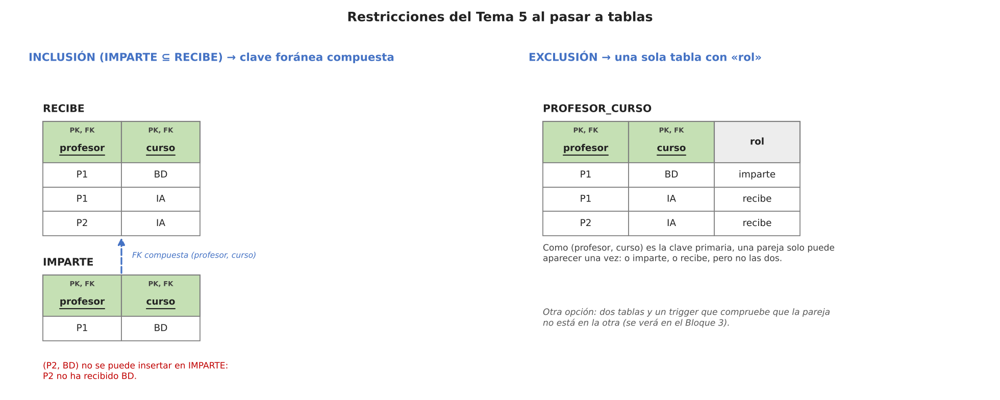

---

## 7. Normalización

Con el diagrama transformado en tablas, hay que comprobar que el diseño es bueno. La **normalización** es un conjunto de reglas (las **formas normales**) que garantizan que las tablas tengan los atributos justos, organizados de forma coherente.

**Los dos objetivos de la normalización:**

1. **Evitar la redundancia innecesaria:** el mismo dato repetido en varios sitios ocupa espacio y puede desincronizarse.
2. **Evitar dependencias erróneas entre atributos:** cada dato debe depender de lo que realmente le corresponde.

### 7.1. El problema: la tabla plana

Mira esta tabla única con todo mezclado:

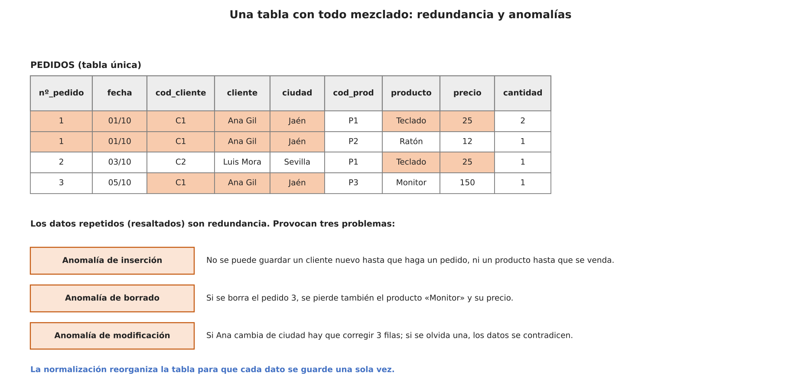

Los datos repetidos (en color) provocan tres **anomalías**:

| Anomalía | Qué ocurre |
|---|---|
| **Inserción** | No podemos guardar un cliente o un producto nuevo hasta que haya un pedido |
| **Borrado** | Al borrar el pedido 3 perdemos también el producto «Monitor» y su precio |
| **Modificación** | Si Ana cambia de ciudad hay que corregir varias filas; si se olvida una, los datos se contradicen |

La normalización **descompone** esta tabla en varias (CLIENTES, PRODUCTOS, PEDIDOS, LINEAS_PEDIDO) donde cada dato se guarda **una sola vez**.

### 7.2. ¿Normalización antes o después del E/R?

Si el diagrama E/R está bien hecho, las tablas resultantes **ya suelen estar en 3FN**. Entonces, ¿para qué normalizar?

- Para **detectar errores del diseño**: un atributo puesto en la entidad equivocada, una dependencia oculta (por ejemplo, `ciudad → provincia` dentro de una entidad), un multivaluado sin separar, un derivado guardado...
- Para **diseñar a partir de datos ya existentes**: una hoja de Excel, una base de datos heredada o una tabla plana que nos dan, donde no hay diagrama E/R previo.

Por eso la normalización se estudia **como un bloque aparte**, con sus propios ejercicios.

El proceso avanza por etapas, las **formas normales**: 1FN, 2FN, 3FN, Boyce-Codd, 4FN, 5FN y dominio-clave. Para entenderlas necesitamos el concepto de **dependencia funcional**.

---

## 8. Dependencias funcionales

Una **dependencia funcional** indica que un conjunto de atributos determina de forma única a otro dentro de la misma tabla. Se escribe `A → B` y se lee «A determina a B»: si conocemos el valor de A, solo puede haber un valor de B.

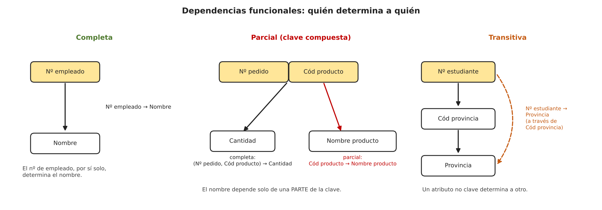

### 8.1. Dependencia funcional completa

`Nº_empleado → Nombre`

El número de empleado, **por sí solo**, determina el nombre. No hace falta nada más.

Con clave compuesta, un atributo tiene dependencia completa si depende de **toda** la clave:

`(Nº_pedido, Cód_producto) → Cantidad`

La cantidad pedida depende del pedido **y** del producto a la vez (la cantidad de teclados en el pedido 1).

### 8.2. Dependencia funcional parcial

Solo ocurre con **claves compuestas**: un atributo depende de **una parte** de la clave, no de toda.

`Cód_producto → Nombre_producto`, estando en una tabla con clave `(Nº_pedido, Cód_producto)`.

El nombre del producto solo depende del código del producto; el número de pedido sobra.

### 8.3. Dependencia funcional transitiva

Un atributo no clave depende de la clave **a través de otro atributo no clave**.

```
Nº_estudiante → Cód_provincia
Cód_provincia → Provincia
Nº_estudiante → Provincia        ← transitiva (pasa por Cód_provincia)
```

El estudiante determina la provincia, pero solo porque determina el código de provincia, y este determina la provincia.

---

## 9. Primera, segunda y tercera forma normal

> 💡 **Regla general:** para que se cumpla una forma normal, deben cumplirse también las anteriores (2FN exige 1FN; 3FN exige 2FN...).

### 9.1. Primera forma normal (1FN)

**Cada celda contiene un único valor** (valores atómicos). No se admiten atributos con varios valores ni grupos que se repiten.

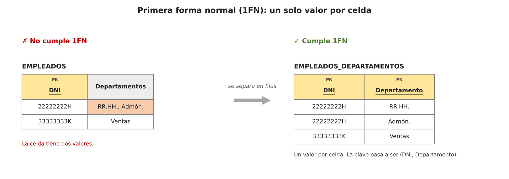

Se soluciona separando en una fila por valor, o (mejor) en una tabla aparte, como hicimos con los multivaluados en el apartado 5.2.

### 9.2. Segunda forma normal (2FN)

**Está en 1FN y todo atributo no clave depende de la clave completa**, no de una parte. Solo puede incumplirse si la **PK es compuesta**.

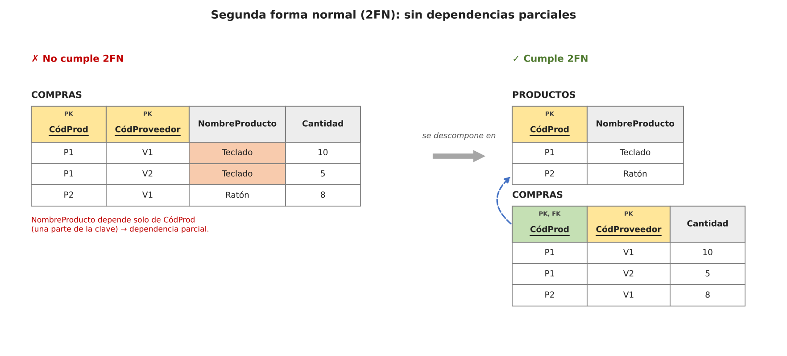

Se soluciona sacando a una tabla nueva el atributo con la parte de la clave de la que depende (`PRODUCTOS`). Si la PK es simple, la tabla ya está en 2FN.

### 9.3. Tercera forma normal (3FN)

**Está en 2FN y ningún atributo no clave depende de otro atributo no clave** (sin dependencias transitivas).

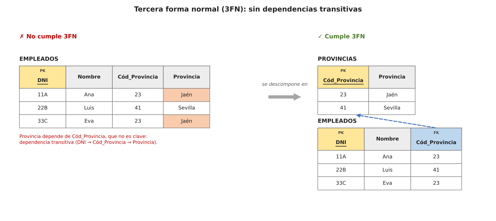

Se soluciona sacando a una tabla nueva el atributo que determina (`Cód_Provincia → Provincia`) y dejándolo como FK en la original.

> 💡 **Truco para recordarlo:** *«Cada atributo depende de la clave (1FN), de toda la clave (2FN) y solo de la clave (3FN)»*.

---

## 10. Forma normal de Boyce-Codd (FNBC)

Es una versión **más estricta** de la 3FN (de Raymond Boyce y Edgar Codd): **todo determinante (lo que está a la izquierda de una dependencia funcional) debe ser clave candidata**.

Solo se diferencia de la 3FN cuando hay **varias claves candidatas compuestas que se solapan**. Ejemplo clásico: tutorías.

- Un alumno puede tener varias asignaturas, pero con **un solo profesor por asignatura**.
- Cada profesor da **una sola asignatura**.
- Dependencias: `(Alumno, Asignatura) → Profesor` y `Profesor → Asignatura`.
- Claves candidatas: `(Alumno, Asignatura)` y `(Alumno, Profesor)`.

La tabla cumple 3FN (todo atributo es parte de alguna clave candidata), pero `Profesor` es determinante sin ser clave candidata → **no cumple Boyce-Codd**. Consecuencia: la asignatura de López (BD) está repetida en cada tutoría.

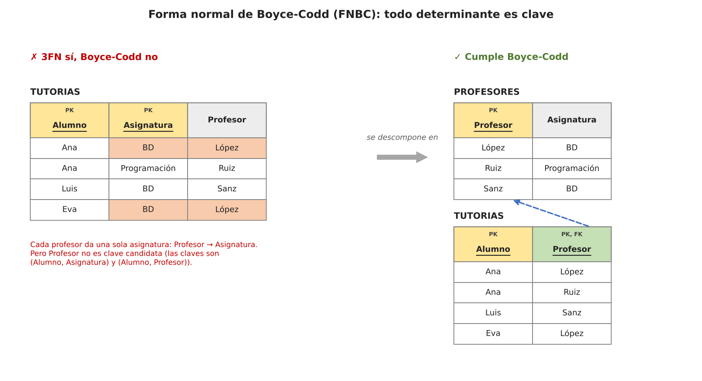

```
PROFESORES (Profesor, Asignatura)
    PK: Profesor

TUTORIAS (Alumno, Profesor)
    PK: (Alumno, Profesor)
    FK: Profesor → PROFESORES(Profesor)
```

> ℹ️ Si tu tabla tiene una sola clave candidata, 3FN y Boyce-Codd coinciden. En la práctica, **llegar a 3FN suele bastar**.

---

## 11. Formas normales restantes: 4FN, 5FN y dominio-clave

> ⚠️ En la práctica **lo recomendable es llegar como máximo hasta 3FN o Boyce-Codd**. Las siguientes tienen sobre todo interés teórico.

| Forma normal | Se basa en | Idea clave |
|---|---|---|
| **4FN** | Dependencias multivaluadas | La tabla no debe mezclar dos hechos independientes que varían libremente (ej: cursos y aficiones de un estudiante, sin relación entre ellos) |
| **5FN** | Dependencias de *join* | La tabla se puede descomponer en otras más pequeñas y volver a unirse sin perder información ni inventar filas |
| **Dominio-clave** | Restricciones y dominios | La más estricta: toda restricción se deduce de las claves y los dominios (ej: la edad entre 18 y 65) |

---

## 12. Desnormalización

Consiste en **introducir redundancia de forma controlada y deliberada** en un modelo ya normalizado para **mejorar el rendimiento de las consultas**: se vuelven a juntar tablas que se habían separado.

**Ventajas:**

- Menos `JOIN`s en consultas complejas.
- Consultas más sencillas de escribir.
- Menos tablas que mantener relacionadas.

**Ejemplos habituales:**

- **Tablas de resumen:** precalcular totales o promedios en lugar de calcularlos en cada consulta.
- **Columnas redundantes:** repetir un dato para evitar un `JOIN`.
- **Fusión de tablas:** juntar varias tablas relacionadas en una sola.

> ⚠️ Es un **equilibrio**: se gana velocidad en lectura, pero se complica mantener la consistencia al escribir (las anomalías vuelven). Solo se aplica cuando el beneficio en consultas frecuentes compensa ese riesgo, y **siempre después** de haber normalizado.

---

## 13. Ejercicios

### Ejercicio 1 — Transformación

Pasa a tablas (indicando PK y FK) estas situaciones:

1. `AUTOR` (id_autor, nombre) y `LIBRO` (isbn, título) con la relación `ESCRIBE`: un autor escribe muchos libros y un libro puede tener varios autores. La relación tiene el atributo `año_edición`.
2. `HOSPITAL` (id_hospital, nombre) y `HABITACION` (nº_habitación, planta), entidad débil de HOSPITAL.
3. `PERSONA` (dni, nombre) con la relación reflexiva `CASADO_CON` (cada persona, como mucho, con una).
4. `EMPLEADO` (dni, nombre, email) donde el email es multivaluado.

<details>
<summary>Solución</summary>

1. N:M → tabla nueva:
   ```
   AUTORES (id_autor, nombre)                  PK: id_autor
   LIBROS (isbn, título)                       PK: isbn
   ESCRIBE (id_autor, isbn, año_edición)
       PK: (id_autor, isbn)
       FK: id_autor → AUTORES(id_autor)
       FK: isbn → LIBROS(isbn)
   ```
2. Entidad débil → PK compuesta:
   ```
   HOSPITALES (id_hospital, nombre)            PK: id_hospital
   HABITACIONES (id_hospital, nº_habitación, planta)
       PK: (id_hospital, nº_habitación)
       FK: id_hospital → HOSPITALES(id_hospital)
   ```
3. Reflexiva 1:1 con (0,1): FK a la misma tabla, `UNIQUE`:
   ```
   PERSONAS (dni, nombre, dni_pareja)
       PK: dni
       FK: dni_pareja → PERSONAS(dni)          [UNIQUE, puede ser NULL]
   ```
4. Multivaluado → tabla propia:
   ```
   EMPLEADOS (dni, nombre)                     PK: dni
   EMAILS_EMPLEADO (dni, email)
       PK: (dni, email)
       FK: dni → EMPLEADOS(dni)
   ```

</details>

### Ejercicio 2 — Dependencias y formas normales

Dada la tabla `MATRICULAS (dni_alumno, cod_asig, nombre_alumno, nombre_asig, nota)` con PK `(dni_alumno, cod_asig)`:

1. Indica qué dependencias funcionales hay y de qué tipo son (completa, parcial).
2. ¿En qué forma normal está? ¿Por qué?
3. Normalízala hasta 3FN.

<details>
<summary>Solución</summary>

1. - `(dni_alumno, cod_asig) → nota` — **completa**.
   - `dni_alumno → nombre_alumno` — **parcial** (depende solo de una parte de la clave).
   - `cod_asig → nombre_asig` — **parcial**.
2. Está en **1FN** (valores atómicos) pero **no en 2FN**, por las dependencias parciales.
3. ```
   ALUMNOS (dni_alumno, nombre_alumno)         PK: dni_alumno
   ASIGNATURAS (cod_asig, nombre_asig)         PK: cod_asig
   MATRICULAS (dni_alumno, cod_asig, nota)
       PK: (dni_alumno, cod_asig)
       FK: dni_alumno → ALUMNOS(dni_alumno)
       FK: cod_asig → ASIGNATURAS(cod_asig)
   ```
   No hay dependencias transitivas: ya está en 3FN.

</details>

### Ejercicio 3 — Normalizar la tabla plana

A partir de la tabla `PEDIDOS` del apartado 7.1 (`nº_pedido, fecha, cod_cliente, cliente, ciudad, cod_prod, producto, precio, cantidad`):

1. Identifica la clave primaria y las dependencias funcionales.
2. Llévala a 3FN y dibuja el esquema resultante con PK y FK.

<details>
<summary>Solución</summary>

1. PK: `(nº_pedido, cod_prod)`. Dependencias:
   - `(nº_pedido, cod_prod) → cantidad` (completa)
   - `nº_pedido → fecha, cod_cliente` (parcial)
   - `cod_prod → producto, precio` (parcial)
   - `cod_cliente → cliente, ciudad` (transitiva desde `nº_pedido`)
2. ```
   CLIENTES (cod_cliente, cliente, ciudad)     PK: cod_cliente
   PRODUCTOS (cod_prod, producto, precio)      PK: cod_prod
   PEDIDOS (nº_pedido, fecha, cod_cliente)
       PK: nº_pedido
       FK: cod_cliente → CLIENTES(cod_cliente)
   LINEAS_PEDIDO (nº_pedido, cod_prod, cantidad)
       PK: (nº_pedido, cod_prod)
       FK: nº_pedido → PEDIDOS(nº_pedido)
       FK: cod_prod → PRODUCTOS(cod_prod)
   ```

</details>

---

## Resumen del tema

```
MODELO RELACIONAL
│
├── Transformación del E/R a tablas
│    ├── Entidad fuerte  → tabla; identificador → PK
│    ├── Entidad débil   → tabla; PK = PK de la fuerte (también FK) + clave parcial
│    ├── Relación 1:1    → sin tabla; FK UNIQUE en la entidad que siempre participa
│    ├── Relación 1:N    → sin tabla; FK en el lado N (+ atributos de la relación)
│    ├── Relación N:M    → tabla nueva; PK compuesta de las dos FK
│    ├── Reflexiva       → FK a la misma tabla
│    ├── Multivaluado    → tabla propia (PK compuesta)    Derivado → no se guarda
│    ├── Ternaria        → tabla con las tres FK; la PK depende de las cardinalidades
│    ├── Jerarquía       → 4 estrategias (superclase+subclases, solo subclases, campo tipo, booleanos)
│    └── Inclusión / exclusión → FK compuesta / trigger o tabla con «rol»
│
├── Normalización
│    ├── 1FN → un valor por celda
│    ├── 2FN → sin dependencias parciales (depende de TODA la clave)
│    ├── 3FN → sin dependencias transitivas (depende SOLO de la clave)
│    ├── Boyce-Codd → todo determinante es clave candidata
│    ├── 4FN, 5FN, dominio-clave → interés teórico
│    └── Objetivo: evitar redundancia y anomalías (inserción, borrado, modificación)
│
└── Desnormalización → redundancia controlada para ganar rendimiento
```
