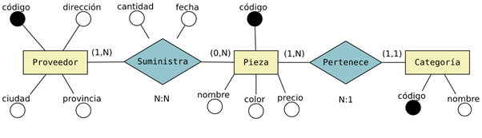
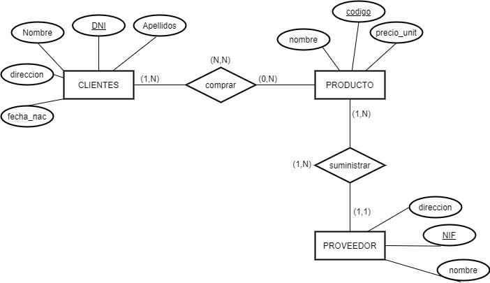

# Ejercicios — Tema 7
# Modelo relacional: transformación del E/R

---

Para cada diagrama E/R, transforma el esquema a un **esquema relacional**. Indica para cada tabla su **clave primaria (PK)** y sus **claves foráneas (FK)**, y razona qué cardinalidad tiene cada relación.

---

## Ejercicio 1 — Proveedores y piezas

Transformación de un esquema E-R a un esquema relacional

---

## Ejercicio 2 - Clientes-productos-proveedores

